<div align="center">


# hsc-academia

**Every question solved, in Bangla and English.**

Question banks for HSC higher maths and physics: about 800 questions across
five topics, each with its answer and a worked solution, typeset in LaTeX.


[Download a set](#try-it) ·
[See the pages](#inside-the-banks) ·
[Build from source](#get-started)

<picture>
<source media="(prefers-color-scheme: dark)" srcset="./.github/assets/readme/banner-dark.jpg" />
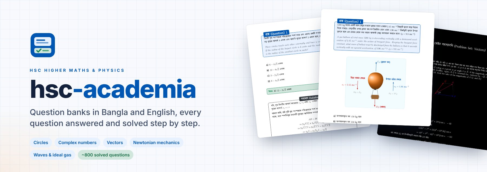
</picture>

</div>

<div align="center">

[At a glance](#at-a-glance) · [Who it's for](#who-its-for) ·
[Inside the banks](#inside-the-banks) · [How a question is built](#how-a-question-is-built) ·
[Coverage](#coverage) · [Quality](#quality-and-checks) ·
[Engineering](#engineering) · [Get started](#get-started) ·
[Status](#project-status-and-next-steps)

</div>

hsc-academia turns the hardest parts of the HSC higher maths and physics
syllabus into practice sets you can print. Every question is written in Bangla
with an English translation beneath it, the multiple-choice ones carry four
options and a highlighted answer, and every question ends in a full worked
solution, with diagrams drawn in TikZ wherever a figure helps. Each topic comes
as a Set A, a Set B and a practice set, so the same material can be used for a
class test, a re-sit and self-study.

## At a glance

| | |
| --- | --- |
| **Five topics** | Circles, complex numbers and polynomials, vectors, Newtonian mechanics, and waves and ideal gas |
| **About 800 questions** | 148 + 150 + 60 + 234 + 210, counted from the LaTeX sources; repeated and revised copies counted once |
| **Bilingual** | Each question in Bangla with an English translation; solutions in Bangla with the maths in standard notation |
| **Solved, not just answered** | Every question has a worked solution; all but five multiple-choice questions have their answer marked |
| **Print-ready** | Over 1,000 A4 pages of compiled PDFs, committed next to their sources |
| **Built with** | XeLaTeX, polyglossia, the Kalpurush font, tcolorbox and TikZ |

## Who it's for

| Who | Use it for |
| --- | --- |
| **HSC candidates** | Topic-by-topic practice with a solution to check every step against |
| **Engineering and university admission candidates** | Harder multiple-choice drills in mechanics, waves and coordinate geometry |
| **Teachers and coaches** | Ready-made Set A and Set B papers for tests and re-tests, plus a practice set for homework |

## Try it

Open a PDF straight from GitHub, download it, or print it.

| Topic | Set A | Set B | Practice |
| --- | --- | --- | --- |
| **Circles** | [Daily Set A](./Circle%20QB/Circle%20Daily%20SetA.pdf) | [Daily Set B](./Circle%20QB/Circle%20Daily%20SetB.pdf) | [Daily practice](./Circle%20QB/Circle%20Daily%20PracticeSet.pdf) |
| **Complex numbers and polynomials** | [Set A](./Complex%20%26%20Polynomials%20QB/Complex%20%26%20Polynomials%20SetA.pdf) | [Set B](./Complex%20%26%20Polynomials%20QB/Complex%20%26%20Polynomials%20SetB.pdf) | [Practice](./Complex%20%26%20Polynomials%20QB/Complex%20%26%20Polynomials%20SetPractice.pdf) |
| **Newtonian mechanics, daily** | [Daily Set A](./NEWTONIAN%20QBANK/Newtonian%20Mechanics%20Daily%20SetA.pdf) | [Daily Set B](./NEWTONIAN%20QBANK/Newtonian%20Mechanics%20Daily%20SetB.pdf) | [Daily practice](./NEWTONIAN%20QBANK/Newtonian%20Mechanics%20Daily%20PracticeSet.pdf) |
| **Newtonian mechanics, weekly** | [Weekly Set A](./NEWTONIAN%20QBANK/Newtonian%20Mechanics%20Weekly%20SetA.pdf) | [Weekly Set B](./NEWTONIAN%20QBANK/Newtonian%20Mechanics%20Weekly%20SetB.pdf) | [Weekly practice](./NEWTONIAN%20QBANK/Newtonian%20Mechanics%20Weekly%20Practice%20Set.pdf) |
| **Ideal gas, multiple choice** | [Set 1](./Waves%20and%20Ideal%20Gas/1.pdf) | [Set 2](./Waves%20and%20Ideal%20Gas/2.pdf) | [Set 3](./Waves%20and%20Ideal%20Gas/3.pdf) |
| **Waves, multiple choice** | [Set 1](./Waves%20and%20Ideal%20Gas/11.pdf) | [Set 2](./Waves%20and%20Ideal%20Gas/22.pdf) | [Set 3](./Waves%20and%20Ideal%20Gas/33.pdf) |
| **Ideal gas, written** | [Set 1](./Waves%20and%20Ideal%20Gas/111.pdf) | [Set 2](./Waves%20and%20Ideal%20Gas/222.pdf) | [Set 3](./Waves%20and%20Ideal%20Gas/333.pdf) |
| **Waves, written** | [Set 1](./Waves%20and%20Ideal%20Gas/1111.pdf) | [Set 2](./Waves%20and%20Ideal%20Gas/2222.pdf) | [Set 3](./Waves%20and%20Ideal%20Gas/3333.pdf) |

The vectors problems are in six parts: [1](./Vector%20QBANK/1.pdf) ·
[2](./Vector%20QBANK/2.pdf) · [3](./Vector%20QBANK/3.pdf) ·
[4](./Vector%20QBANK/4.pdf) · [5](./Vector%20QBANK/5.pdf) ·
[6](./Vector%20QBANK/6.pdf).

## Inside the banks

Every image below is a real page from the committed PDFs, cropped to its top half.

<div align="center">

<table>
<tr>
<td width="50%" valign="top">
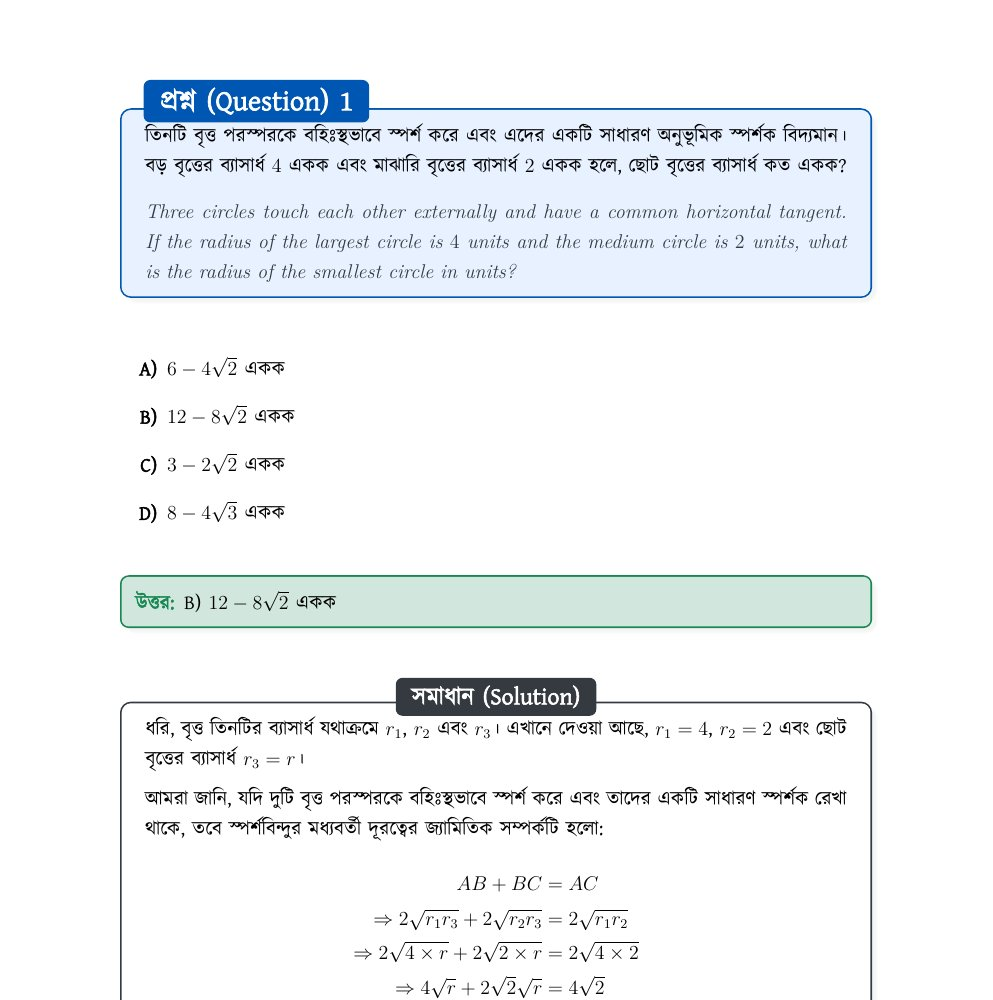
<p><b>Circles.</b> Question, translation, four options, the answer in green and the worked solution, on one page.</p>
</td>
<td width="50%" valign="top">
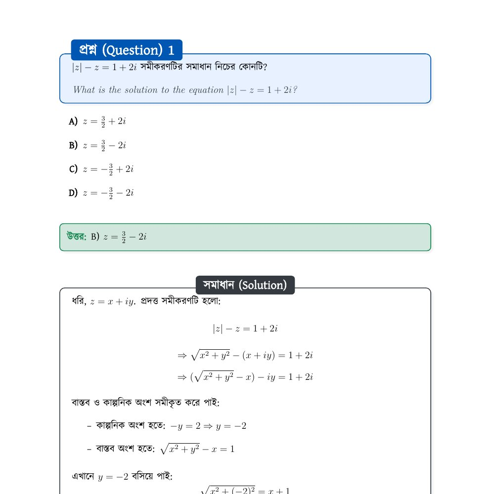
<p><b>Complex numbers and polynomials.</b> Each step of the algebra written out, not just the result.</p>
</td>
</tr>
<tr>
<td width="50%" valign="top">
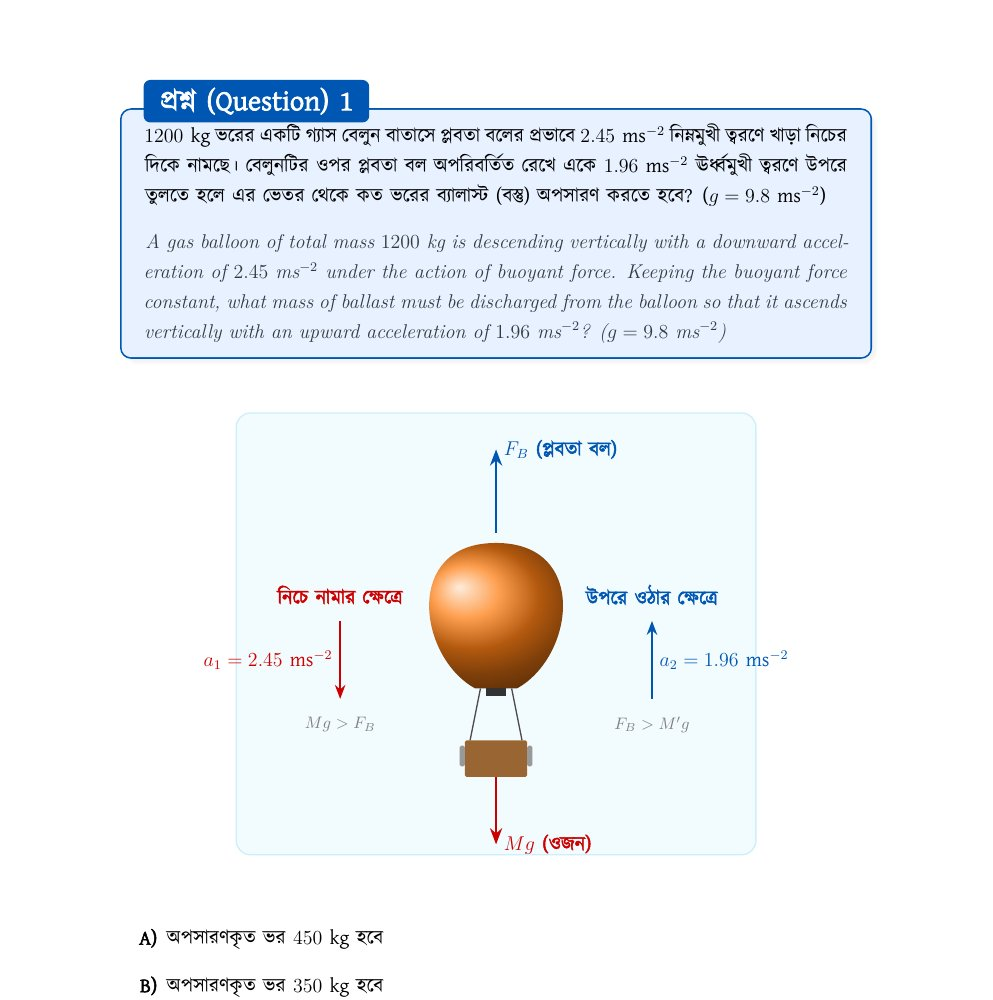
<p><b>Newtonian mechanics.</b> Force diagrams drawn in TikZ, labelled in Bangla, beside the question they belong to.</p>
</td>
<td width="50%" valign="top">
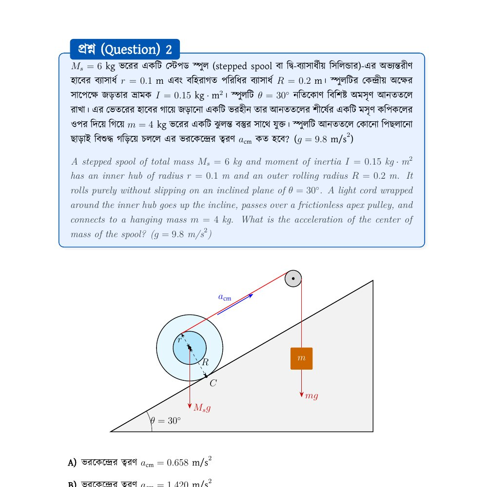
<p><b>Harder mechanics.</b> Rolling bodies, pulleys and inclines, at admission-test difficulty.</p>
</td>
</tr>
<tr>
<td width="50%" valign="top">
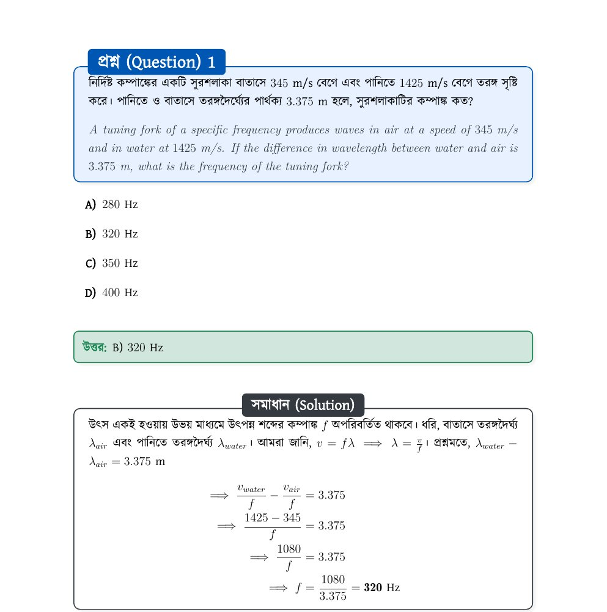
<p><b>Waves.</b> Sound, strings and resonance, with the units carried through every line.</p>
</td>
<td width="50%" valign="top">
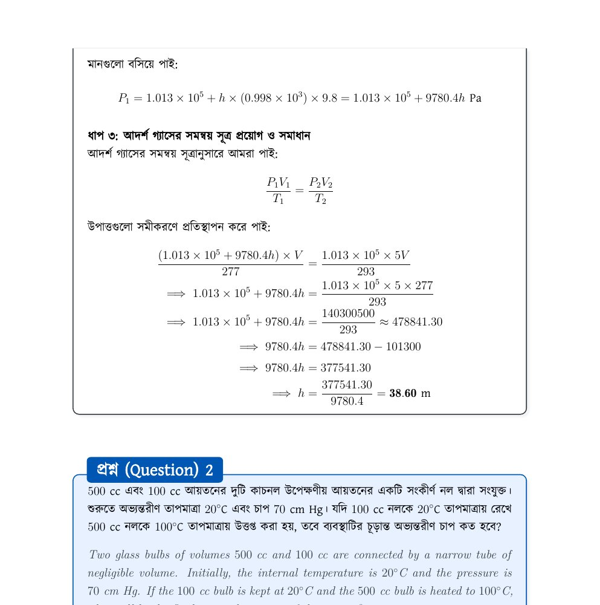
<p><b>Ideal gas.</b> Gas laws and kinetic theory, solved from the stated principle to the number.</p>
</td>
</tr>
<tr>
<td width="50%" valign="top">
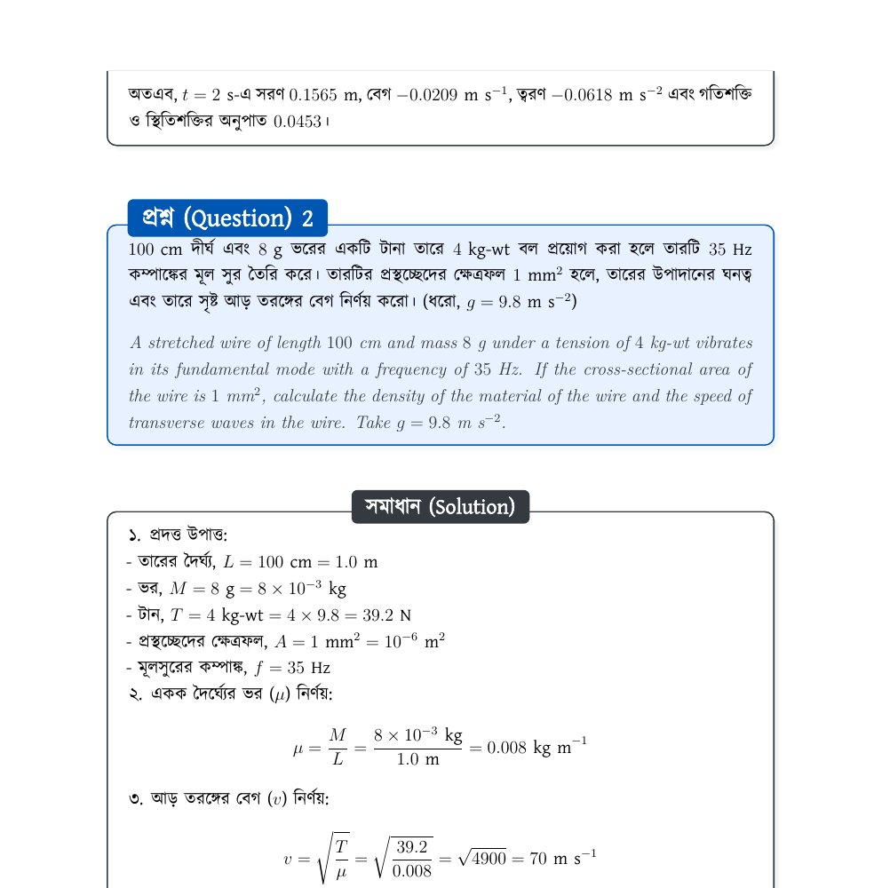
<p><b>Written questions.</b> Board-style creative questions, solved part by part.</p>
</td>
<td width="50%" valign="top">
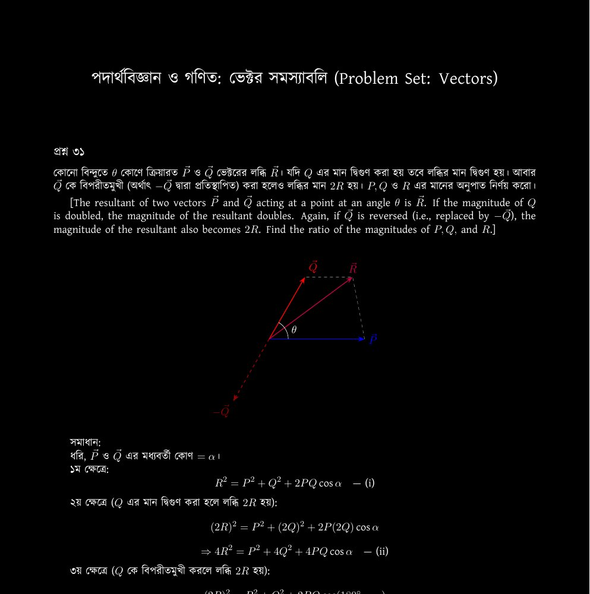
<p><b>Vectors.</b> A dark-page problem set: 60 worked problems with vector diagrams.</p>
</td>
</tr>
</table>

</div>

## How a question is built

Every multiple-choice question in the banks follows the same four boxes, defined
once at the top of each source file as `tcolorbox` styles.

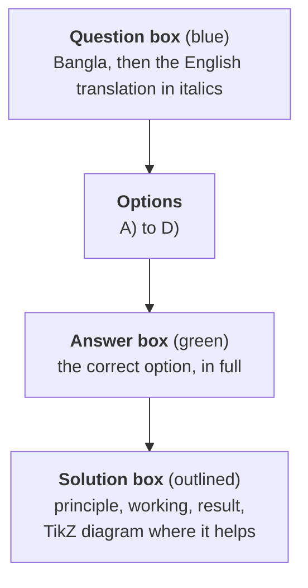

Written questions keep the question and solution boxes and drop the options and
the answer box, since the solution is the answer. The vectors set uses its own
simpler layout: a numbered heading, the question, then the solution.

### How a set becomes a PDF

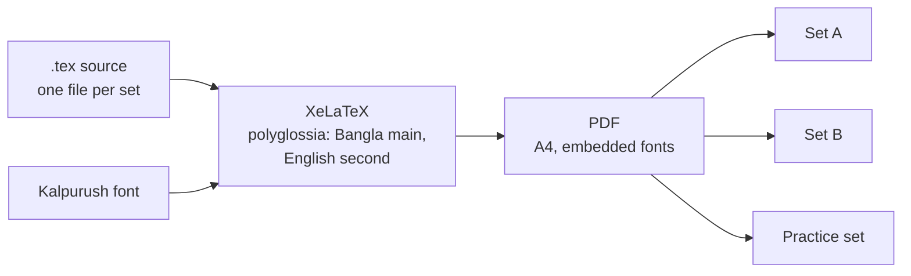

### Set types

| Set | What it is | Questions |
| --- | --- | --- |
| **Daily Set A / Set B** | A full multiple-choice paper for a class test and its re-test | 25 to 50 each |
| **Daily practice** | A third paper of the same kind, for homework or self-study | 25 to 50 |
| **Weekly** | Longer, harder mechanics questions, for a weekly test | 20 each |
| **Written** | Board-style creative questions, solved part by part | 10 each |

## Coverage

Counted from the LaTeX sources on 25 Nov 2026. Where a set exists in an original
and a revised version, it is counted once.

| Topic | Folder | Sets | Questions | Format | PDF pages |
| --- | --- | --- | --- | --- | --- |
| Circles | `Circle QB/` | 3 | 148 (50 · 48 · 50) | Multiple choice | 181 |
| Complex numbers and polynomials | `Complex & Polynomials QB/` | 3 | 150 (3 × 50) | Multiple choice | 166 |
| Vectors (physics and maths) | `Vector QBANK/` | 6 parts | 60 | Worked problems | 59 |
| Newtonian mechanics | `NEWTONIAN QBANK/` | 3 daily, 3 weekly, 1 revised | 234 (150 daily · 60 weekly · 24 revised) | Multiple choice | 446 |
| Waves and ideal gas | `Waves and Ideal Gas/` | 6 multiple choice, 6 written | 210 (150 · 60) | Both | 218 |
| **Total** | | | **802** | | **1,070** |

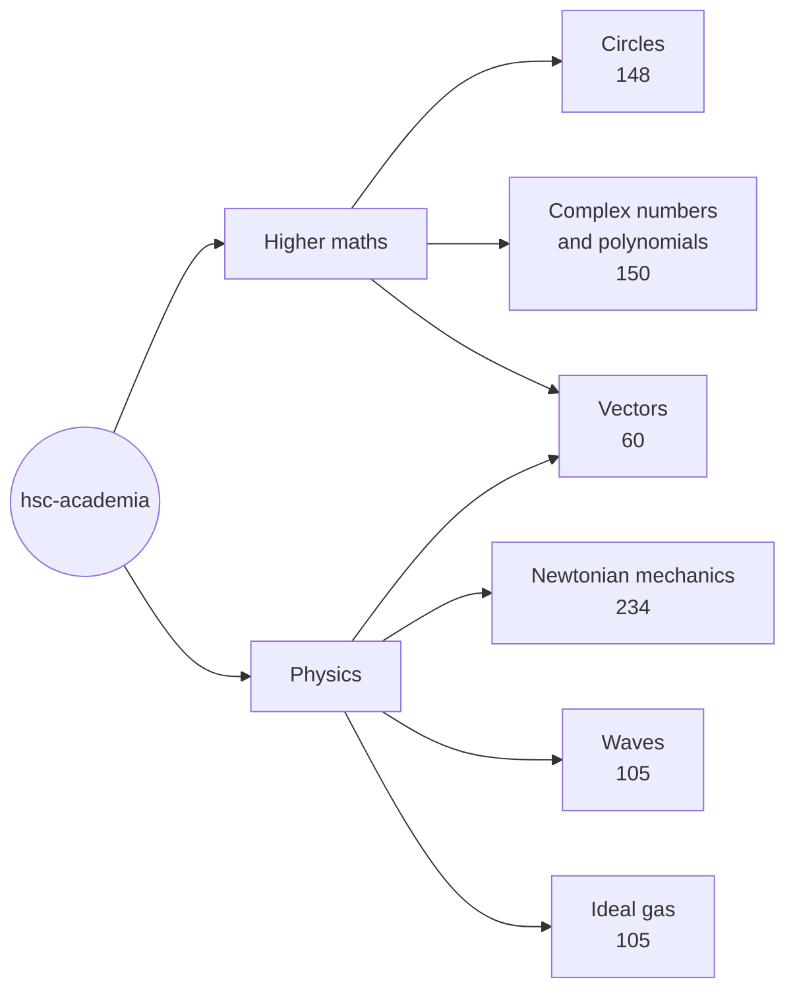

## Quality and checks

| Area | What is in place |
| --- | --- |
| **One layout** | Question, answer and solution boxes are defined once per file, so every question looks and reads the same |
| **Bilingual by design** | The English translation sits under each Bangla question, so a reader of either language can follow |
| **Units** | Physics values are typeset with `siunitx`, so units stay consistent and correctly spaced |
| **Diagrams in code** | Figures are TikZ, not pasted images, so they stay sharp at any zoom and can be edited in the source |
| **Embedded fonts** | The PDFs embed Kalpurush and the maths fonts, so they look the same on every device and printer |

### Checked on 25 Nov 2026

| Check | Result |
| --- | --- |
| **Questions counted** | 932 question boxes across 30 source files, plus 60 vectors problems; 802 once repeats and revisions are removed |
| **Every question has a solution** | 932 of 932 question boxes have a solution box |
| **Answers marked** | Every multiple-choice question has its answer box except five: one each in the weekly sets `11.tex` and `22.tex` and the revised `1111.tex`, and two in `modified.tex` |
| **PDFs** | Every committed set opens, with Kalpurush embedded; produced by XeLaTeX |

What this does not prove:

| Item | Status |
| --- | --- |
| Every answer and solution is correct | **Not reviewed.** No second person has checked the working yet |
| The sources build from a clean checkout | **Not re-checked here.** It needs the Kalpurush font installed |
| An errata list | **None yet** |

## Engineering

### Technology

| Layer | Technology |
| --- | --- |
| Engine | XeLaTeX (the PDFs were built with MiKTeX) |
| Language | `polyglossia` with Bangla as the main language and English as the second |
| Font | Kalpurush for Bangla; Latin Modern for maths and English |
| Layout | `tcolorbox` for the question, answer and solution boxes; `geometry` for A4 margins |
| Maths and units | `amsmath`, `amssymb`, `siunitx` |
| Diagrams | TikZ, with the `arrows.meta`, `angles`, `quotes`, `calc` and `intersections` libraries |

### Decisions and trade-offs

- **Bangla first, English beneath.** Students sit the HSC in Bangla, but
  admission tests and many textbooks use English terms. Printing both costs
  space on the page, and saves a student from translating in their head.
- **One self-contained file per set.** Each `.tex` carries its own preamble, so
  any set builds on its own. The cost is that a style change has to be copied into
  every file.
- **PDFs committed with their sources.** Anyone can download a set without
  installing LaTeX. The cost is a heavier repository and PDFs that can drift from
  their sources if one is edited without rebuilding.
- **Diagrams as TikZ.** Sharp at any size and editable, at the cost of slower
  builds and more effort per figure than a scanned drawing.

## Get started

### Requirements

- A TeX distribution with XeLaTeX: TeX Live or MiKTeX
- The Kalpurush Bangla font, installed system-wide

### Build a set

```sh
git clone https://github.com/Kairo-2081/hsc-academia.git
cd hsc-academia/"Circle QB"
xelatex 1.tex
```

Run it twice if cross-references or boxes look unsettled. MiKTeX installs missing
packages on first build; on TeX Live, `tlmgr install` any package it reports missing.

### Which file is which

The sources are numbered, not named. This map says what each one is.

| Folder | Files | What they are |
| --- | --- | --- |
| `Circle QB/` | `1`, `2`, `3` | Daily Set A, Set B and practice set |
| `Complex & Polynomials QB/` | `1`, `2`, `3` | Set A, Set B and practice set. `Complex Set*.pdf` are shorter PDFs with no source in the repository |
| `Vector QBANK/` | `1` to `6` | Problems 1 to 60, in order |
| `NEWTONIAN QBANK/` | `1`, `2`, `3` | Daily Set A, Set B and practice set |
| | `11`, `22`, `33` | Weekly Set A, Set B and practice set |
| | `111`, `1111`, `2222` | Revised versions of daily Set A and weekly Sets A and B |
| | `222`, `333` | The same questions as `2` and `3` |
| | `modified` | A revised set of 24 questions |
| `Waves and Ideal Gas/` | `1`, `2`, `3` | Ideal gas, multiple choice |
| | `11`, `22`, `33` | Waves, multiple choice |
| | `111`, `222`, `333` | Ideal gas, written |
| | `1111`, `2222`, `3333` | Waves, written |

### Repository layout

```text
Circle QB/                 circles: 3 sets, sources and PDFs
Complex & Polynomials QB/  complex numbers and polynomials: 3 sets
Vector QBANK/              vectors: 60 problems in 6 parts
NEWTONIAN QBANK/           Newtonian mechanics: daily, weekly and revised sets
Waves and Ideal Gas/       waves and ideal gas: multiple-choice and written sets
.github/assets/readme/     the logo, banners and page previews in this README
```

## Project status and next steps

- **A second reader:** have every answer and solution checked by someone else, and
  keep an errata list for anything found.
- **Clearer names:** rename the numbered sources (`11.tex`, `1111.tex`) to say what
  they are, such as `waves-mcq-set-a.tex`.
- **One copy of each set:** `NEWTONIAN QBANK/222.tex` and `333.tex` hold the same
  questions as `2.tex` and `3.tex`; keep one of each.
- **Tidy the repository:** stop committing build files (`.aux`, `.log`) with a
  `.gitignore`; 75 are tracked today.
- **A shared preamble:** move the common styles into one `.sty` file so a change is
  made once.
- **More topics:** the rest of the higher maths and physics syllabus, in the same format.

## License

No licence has been chosen yet, so all rights are reserved by the author.
